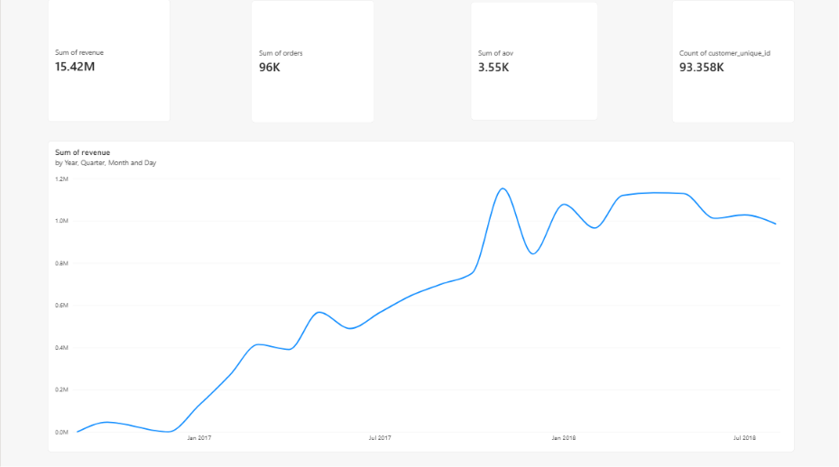
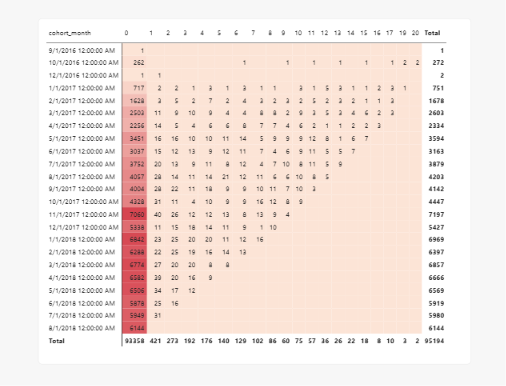
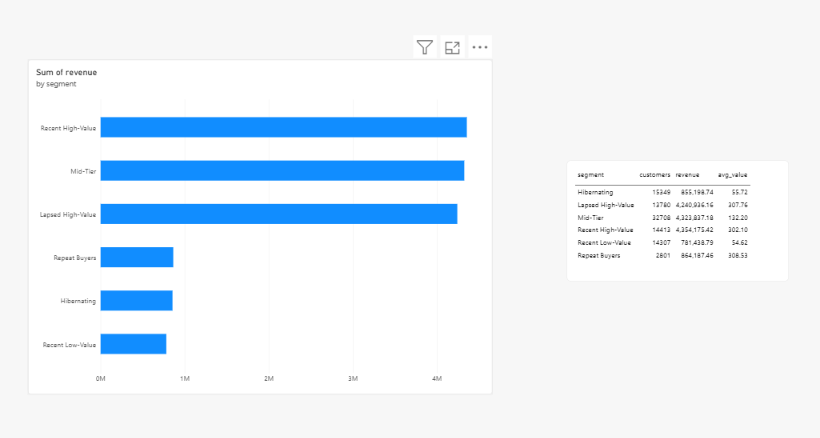

# Olist Retail Analytics — SQL + Power BI

Customer segmentation and retention analysis on the [Olist Brazilian e-commerce dataset](https://www.kaggle.com/datasets/olistbr/brazilian-ecommerce) (~99K orders, ~93K unique customers, 2016–2018). PostgreSQL for the analytical layer, Power BI for the dashboard.

**Question it answers:** *In a business where almost nobody buys twice, which customers and categories are worth spending retention/marketing budget on?*

---

## Headline findings (from the real data)

| Fact | Value |
|---|---|
| Delivered orders | 96,478 |
| Unique customers (`customer_unique_id`) | 93,358 |
| Total revenue (price + freight) | R$ 15.42M |
| **One-time buyers** | **97.0% of customers → 94.4% of revenue** |
| **Repeat buyers (≥2 orders)** | 3.0% of customers → **5.6% of revenue, ~2× the avg LTV** (R$309 vs R$161) |

**So what:** retention spend has a small addressable base, so the higher-ROI lever is *acquisition quality* — concentrating on the high-monetary one-time segments (`Recent High-Value`, `Lapsed High-Value`) that already drive ~56% of revenue, while protecting the tiny but disproportionately valuable repeat cohort.

### RFM segments (customers by value)
| Segment | Customers | % Revenue | Avg value |
|---|---|---|---|
| Recent High-Value | 14,413 | 28.2% | R$302 |
| Mid-Tier | 32,708 | 28.0% | R$132 |
| Lapsed High-Value | 13,780 | 27.5% | R$308 |
| Repeat Buyers | 2,801 | 5.6% | R$309 |
| Hibernating | 15,349 | 5.5% | R$56 |
| Recent Low-Value | 14,307 | 5.1% | R$55 |

---

## Two design decisions worth knowing (and defending in interview)

1. **`customer_id` is not a person.** In Olist it is regenerated per order; the true identity is `customer_unique_id`. Every RFM/cohort join goes through it — otherwise every customer looks like a one-time buyer and repeat behaviour disappears.
2. **A textbook Frequency score is degenerate here.** With 97% one-time buyers, an F-quintile is meaningless, so segments are driven by **Recency × Monetary**, and the rare repeat buyers (`frequency ≥ 2`) are isolated as their own segment. R/F/M quintiles are still computed to show the technique, but the segmentation is adapted to what the data actually supports. This is the difference between running a template and reading the data.

---

## Repo layout
```
sql/
  01_schema.sql            PostgreSQL DDL (9 tables, keys, indexes)
  00_load.sql              \copy loader for the raw CSVs
  02_rfm.sql               v_rfm  — RFM scores + segment per customer
  03_cohort_and_kpis.sql   v_cohort, v_monthly_kpis, v_category_revenue
scripts/
  run_duckdb.py            zero-setup path: runs the whole pipeline + re-exports CSVs
outputs/                   Power BI-ready extracts (regenerated by the pipeline)
powerbi/MODEL_AND_DAX.md   data model, DAX measures, dashboard page plan
```

## Run it

**Option A — PostgreSQL (matches the deployed stack):**
1. Download the dataset from Kaggle and drop the CSVs in `data/`.
2. ```bash
   psql "$DATABASE_URL" -f sql/01_schema.sql
   psql "$DATABASE_URL" -f sql/00_load.sql
   psql "$DATABASE_URL" -f sql/02_rfm.sql
   psql "$DATABASE_URL" -f sql/03_cohort_and_kpis.sql
   ```
3. Point Power BI at the database (Get Data → PostgreSQL) and import the `v_*` views. See `powerbi/MODEL_AND_DAX.md`.

**Option B — DuckDB (no DB install, reproduces every number above):**
```bash
pip install duckdb
python scripts/run_duckdb.py
```
This runs the exact same view SQL against the CSVs and rewrites `outputs/`.

> All figures in this README were produced by the pipeline. Re-run it before quoting any number on a resume so it's yours, not copied.

## Notes / limitations
- Raw data isn't committed (Kaggle license, ~120 MB) — download it yourself; `.gitignore` excludes `data/*.csv`.
- Cohort *retention* is intentionally sparse: it reflects the real ~3% repeat rate, and that sparsity is a finding, not a bug.
- Revenue = item `price` + `freight_value` on `delivered` orders. Swap in `order_payments.payment_value` if you want gross paid amounts instead.

## Dashboard




